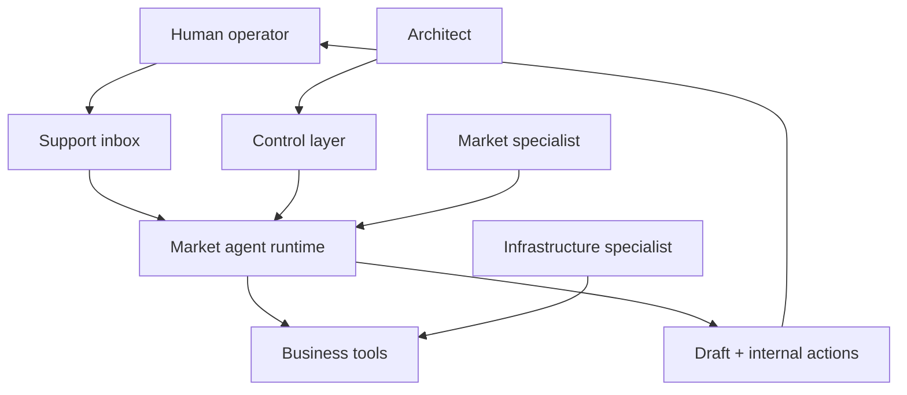

# Architecture

The system separates behavioural design from runtime infrastructure and from day-to-day market training.

The Mermaid source is also available in [`diagrams/fleet-architecture.mmd`](../diagrams/fleet-architecture.mmd).

## Control layer

The agent is not governed by one prompt. Each file has a distinct responsibility:

| Layer | Contains | Change trigger |
|---|---|---|
| Identity | Voice, boundaries, ownership, external-send restriction | Persona or safety change |
| Operational skill | Classification, retrieval, decisions, actions and escalation | Workflow or market change |
| References | Product and process facts | Knowledge update |
| Baseline | Expected responses to known failure classes | New incident or rule change |
| Health Card | Host, connections, state, risks and last verification | Deployment/status change |
| Stability Protocol | Safe edit, test, rollback and reporting procedure | Governance improvement |

## Runtime flow

1. Read the new customer message and the required thread context.
2. Classify the request before composing a response.
3. Load the smallest authoritative reference set that can answer it safely.
4. Retrieve order, product or logistics records when the answer depends on live data.
5. Draft the reply using only verified facts.
6. Prepare internal notes, tags, handoffs or alerts.
7. Stop before external send and leave the final decision to a human.

## Controlled agent changes

The runtime can edit its workspace and scheduled jobs, but that capability is operator-directed:

1. an authorised operator provides the intended rule or Markdown change;
2. the agent applies the bounded edit;
3. the operator inspects the result;
4. baseline and smoke tests are run;
5. the change is accepted or rolled back.

This is different from an agent independently redefining its own goals.

## Integration boundary

Infrastructure specialists own hosts, credentials and connectors. The behavioural architect owns what the agent should do with a successfully connected tool. A platform connection does not imply authorship of the workflow that uses it.
